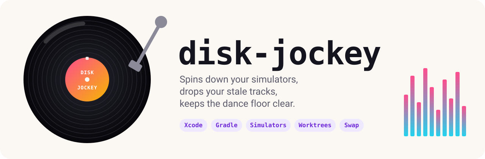
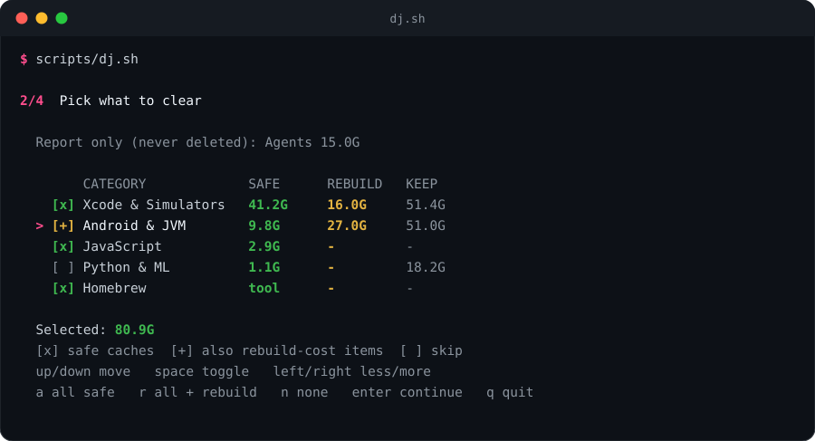
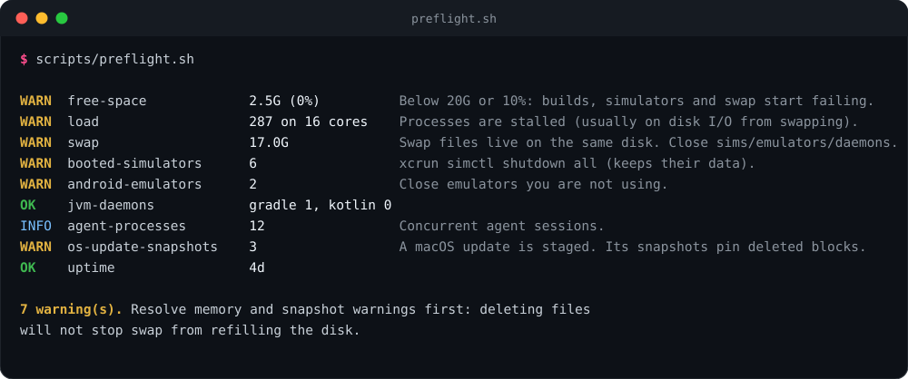
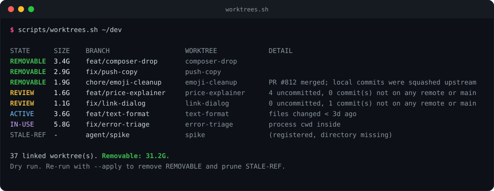
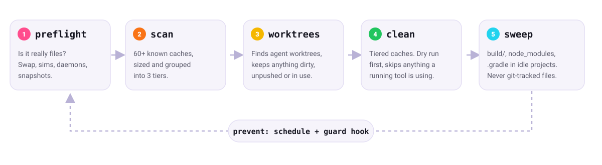

<p align="center">
  
</p>

<p align="center">
  
  
  
  <a href="https://github.com/bmcreations/disk-jockey/actions/workflows/ci.yml"></a>
  <a href="https://github.com/bmcreations/disk-jockey/releases/latest"></a>
  
</p>

<p align="center">
  <b>Disk hygiene for the agentic era.</b><br>
  Finds what is really eating your drive, then removes only what is provably safe.
</p>

---

## Why this exists

AI agents work in parallel. Each task gets its own git worktree with its own full Gradle or Xcode build. Test runs clone simulators. Daemons, emulators and simulators stay up until memory spills into swap, and swap lives on the same disk.

On one real 1TB machine, free space went from **79G to 2.5G in twenty minutes**. The cause wasn't `~/Library/Caches`:

- **17G of swap** from booted simulators, emulators and idle daemons (kernel_task had written 643GB)
- **37 forgotten agent worktrees** nested in `repo/.claude/worktrees/`, about 1 to 6G each
- **A staged macOS update** whose snapshots pinned every block deleted since

A generic "clear your caches" script finds none of that. disk-jockey checks for it first.

## Quick start

```bash
curl -fsSL https://github.com/bmcreations/disk-jockey/releases/latest/download/install.sh | bash
```

That installs the latest release once for every agent and adds a `disk-jockey` command:

- `~/.agents/skills/disk-jockey` is the copy Codex and Cursor read.
- `~/.claude/skills/disk-jockey` links to it for Claude Code (a junction on Windows, so no Developer Mode needed).
- `~/.local/bin/disk-jockey` is the command (`~/bin` in Git Bash). If that folder isn't on your PATH, the installer prints the line to add.

An existing clone in `~/.claude/skills` is moved to the shared location rather than duplicated. Update with `disk-jockey update`; remove with `bash ~/.agents/skills/disk-jockey/install.sh --uninstall`.

Then tell your agent *"my disk is full"*, or drive it yourself:

```bash
disk-jockey                 # interactive: preflight fixes, pick categories, pick worktrees, apply
disk-jockey preflight       # memory, swap and snapshots, before touching files
disk-jockey scan            # where the space is, by tier
disk-jockey worktrees ~/dev # stale agent worktrees
disk-jockey clean           # dry run; add --apply to act
disk-jockey quarantine on   # optional: move instead of delete, with undo
disk-jockey autopilot on    # and never run any of this again
```

Arrow keys move, space toggles, Enter continues. Every command takes `--help`.

<details>
<summary><b>Other ways to install</b></summary>

**Follow `main` instead of releases:**
```bash
curl -fsSL https://raw.githubusercontent.com/bmcreations/disk-jockey/main/install.sh | bash
```

**Manually, without the installer:**
```bash
git clone https://github.com/bmcreations/disk-jockey ~/.agents/skills/disk-jockey
mkdir -p ~/.claude/skills && ln -s ~/.agents/skills/disk-jockey ~/.claude/skills/disk-jockey
```
Then run `~/.agents/skills/disk-jockey/bin/disk-jockey`, or the scripts in `scripts/` directly.

**claude.ai:** download `disk-jockey-vX.Y.Z.zip` from [Releases](https://github.com/bmcreations/disk-jockey/releases/latest) and upload it as a custom skill.

**Pin a version:** `bash install.sh --ref v0.3.0`

</details>

## See it work

**Interactive mode.** Arrow keys and space, like an installer. Safe caches are preselected, rebuild-cost items are one more press (or right arrow), and report-only data can't be selected at all. The worktree step works the same way: REMOVABLE worktrees start selected, and REVIEW ones (uncommitted or unpushed work) can be opted in after typing `yes`. Their commits stay on their branches; only uncommitted changes are discarded.

<p align="center"></p>

**Step one is always: is it really files?**

<p align="center"></p>

**Then the usual biggest win: agent worktrees.** Merged and clean ones go. Anything dirty, unpushed, recently touched or in use by a running agent stays.

<p align="center"></p>

## How it works

<p align="center"></p>

| Script | What it does |
|---|---|
| `dj.sh` | Interactive mode for humans: one-key preflight fixes, arrow-key pickers for categories and worktrees, before/after summary |
| `preflight.sh` | Free space, load, memory pressure, swap, memory by group (simulators, emulators, Claude sessions, the Claude app, Gradle), idle daemons, active builds, APFS snapshots, uptime |
| `scan.sh` | Sizes 100+ known targets, including build folders whose project is gone, across Xcode, simulators, Android, Gradle, Node, Python, Go, Rust, Flutter, Docker, editors, Electron apps, game engines and version managers |
| `worktrees.sh` | Audits every linked worktree, nested ones included. Detects squash-merged PRs with `gh`. `--merged` cleans up right after a merge |
| `clean.sh` | Tiered cleanup with the tools' own commands where they exist (`simctl`, `brew cleanup`, `pnpm store prune`) |
| `sweep.sh` | `build/`, `.gradle`, `node_modules`, `target/`, `.build` in projects idle for N days |
| `autopilot.sh` | Background job that keeps free space above a target: orphans and merged worktrees always, then idle build output oldest first |
| `schedule.sh` | Daily tier-1 cleanup, only when free space drops below a threshold (launchd or systemd) |
| `quarantine.sh` | Opt-in undo: cleanup moves items aside for N days instead of deleting them |
| `mcp.sh` | MCP server: agents acquire and release devices, check disk status, clean up merged worktrees |
| `hooks.sh` | Agent hooks: cap booted devices across sessions, warn agents under memory pressure, shut down what sessions booted |
| `disk-guard.sh` | One-line low-disk warning for agent SessionStart hooks |

Each script is also a `disk-jockey` subcommand: `disk-jockey scan`, `disk-jockey worktrees`, and so on (`dj.sh` is plain `disk-jockey`).

## Safe by default

| Tier | What | Behavior |
|:---:|---|---|
| **1** | Pure caches: DerivedData, XCTest clones, build caches, package caches | `clean.sh --apply` |
| **2** | Costs a re-download or rebuild: Gradle dependencies, DeviceSupport, Maven, Cargo | Opt in with `--tier 2` |
| **3** | Holds real data: Xcode archives (dSYMs), AVDs, simulators, agent transcripts, models | Reported, **never deleted** |

- **Dry run first**, every script. Nothing is deleted without `--apply`.
- **Protected paths** can't be deleted, nor any folder containing them: `debug.keystore`, `gradle.properties` (signing secrets), `.ssh`, Keychains, provisioning profiles, agent settings.
- **Busy checks.** A target is skipped while a process using it runs (`xcodebuild`, `GradleDaemon`, `qemu-system`).
- **In-use checks fail safe.** Worktrees and projects with a process inside are skipped (read from `/proc` on Linux and Git Bash, `lsof` on macOS). On Windows, each folder is also test-renamed right before deletion: Windows refuses that while any program has the folder open. If processes can't be inspected at all, `--apply` refuses to run rather than assuming nothing is in use.
- **Only your files.** Deletion happens under your home folder, plus agent scratch two levels inside `/tmp` (Claude Code keeps per-session scratchpads in `/private/tmp/claude-UID` on macOS), and only folders you own that nobody touched for 3 days.
- **Symlinks** are never followed or deleted.
- **Color** only on an interactive terminal. Agents reading through a pipe get plain text. `NO_COLOR=1` turns it off, `FORCE_COLOR=1` forces it.
- **Worktrees** are removed only via `git worktree remove`, which refuses dirty trees. The one exception is a REVIEW worktree you select yourself and confirm by typing `yes`: its uncommitted changes are discarded, its commits stay on its branch. Branches are never deleted.
- **Sweep** deletes a build folder only next to its build file, and never anything git tracks.

## Undo, if you want it

Off by default, because a held item frees no space until it's purged. Turn it on when you'd rather be able to take something back:

```bash
disk-jockey quarantine on --days 7   # clean, sweep and worktrees now move instead of delete
disk-jockey quarantine list
disk-jockey quarantine restore --last
disk-jockey quarantine purge --all   # free the space now
```

Or for a single run: `disk-jockey clean --apply --quarantine`. Worktrees are moved with `git worktree move`, so even a REVIEW worktree's uncommitted changes come back on restore. Items older than the retention are purged on the next `--apply`. Tool-run cleanups (`npm cache clean`, `brew cleanup`) can't be undone, so they're skipped while quarantine is on, and anything on a different disk than `~/.disk-jockey` is left in place rather than copied.

## Keep the floor clear

**Autopilot, so nobody has to run disk-jockey.**

```bash
disk-jockey autopilot on --target 80G --floor 20G
```

A background job under your own account (launchd, systemd `--user` or Task Scheduler; no root) checks free space every 5 minutes, which costs one `df`. Every 30 minutes, or right away when free space falls under the floor, it runs a pass:

1. **Always:** build folders of deleted projects, merged worktrees with nothing uncommitted, expired quarantine.
2. **Only while free space is under the target**, oldest output first, stopping as soon as it's back above: tier-1 caches, build output of projects idle 14 days, then 7, build caches unused for 2 days, then projects idle 3 days.
3. **Out of safe steps and still short:** one notification saying what's left (swap, a staged macOS update, REVIEW worktrees), at most every 6 hours.

It never deletes tier 2 or 3, worktrees holding uncommitted or unpushed work, or anything a running process is using. It waits for power before the ladder when on battery, unless under the floor. With quarantine on, moved items count towards the target, and under the floor the oldest quarantined items are purged first. `disk-jockey autopilot status` shows the last pass; `--dry-run` on `autopilot run` shows what a pass would do.

**Build folders of deleted worktrees go on their own.** Every worktree gets its own Xcode DerivedData and XcodeBuildMCP workspace, and both stay behind after the worktree is deleted (XcodeBuildMCP never sweeps them: [#526](https://github.com/getsentry/xcodebuildmcp/issues/526), 143 GB in that report). Each folder records the project it was built from (`WorkspacePath` in Xcode's `info.plist`, `workspaceRoot` in XcodeBuildMCP's daemon record), so disk-jockey deletes one only when every recorded project is gone: no idle-time guessing. A folder that records nothing, a project on an unmounted drive, or a workspace whose root still exists is kept. It runs from the session hooks (in the background, at most every 10 minutes) and on every scheduled run regardless of free space, or by hand with `disk-jockey clean --orphans --apply`.

**Clean up worktrees the moment a PR merges.** The agent that opened the PR knows when it merged. Tell it, or put it in your `CLAUDE.md` / `AGENTS.md`:

```bash
cd <main checkout> && disk-jockey worktrees --merged --apply
```

`--merged` only touches clean worktrees whose PR is merged (checked with `gh`) or whose branch is merged into main, regardless of how recently they were used. Run from inside the worktree itself, it refuses and tells you where to `cd`.

**Keep parallel sessions from drowning the machine.** Seven sessions each booting their own simulator, emulator and Gradle build is how a 36 GB Mac ends up in swap. `disk-jockey hooks` prints a Claude Code `settings.json` snippet with three hooks:

- **Device cap (PreToolUse).** Once 2 simulators or 1 emulator are booted across all sessions, booting another is denied and the agent is told which devices to reuse by UDID. Booting one that's already running is always allowed. Change the cap with `disk-jockey hooks limit --simulators 3`.
- **[loupe](https://github.com/bmc08gt/loupe) claims, when it's running.** If a loupe server answers (its token in `~/Library/Caches/loupe/token`), the cap lists each booted device as free, claimed by another session, or hands off, sends agents to a free one with the command to claim it, and warns an agent about to drive a simulator another session claimed. Set `loupe_url` in `~/.disk-jockey/config` if it isn't on `https://localhost:18456`.
- **Memory pressure warnings.** When macOS (or Linux PSI) reports pressure, agents get a note at session start and before builds: reuse booted devices, don't start parallel builds, stop idle daemons.
- **Cleanup at the end (SessionEnd).** When the last session exits, everything booted since the first one started is shut down (simulators keep their data). While any other session is running, nothing is touched. Session start also warns on low disk.

Unrelated tool calls exit in a few milliseconds, and a hook that times out never blocks the tool call.

```json
{
  "hooks": {
    "SessionStart": [
      { "hooks": [ { "type": "command", "command": "bash ~/.agents/skills/disk-jockey/scripts/hooks.sh session-start --guard 20G", "timeout": 10 } ] }
    ],
    "PreToolUse": [
      { "matcher": "Bash|mcp__.*", "hooks": [ { "type": "command", "command": "bash ~/.agents/skills/disk-jockey/scripts/hooks.sh pre-tool", "timeout": 5 } ] }
    ],
    "SessionEnd": [
      { "hooks": [ { "type": "command", "command": "bash ~/.agents/skills/disk-jockey/scripts/hooks.sh session-end", "timeout": 15 } ] }
    ]
  }
}
```

Other agents can call `hooks.sh session-start --session ID` and `session-end --session ID` from their own hooks.

**Let agents coordinate devices directly (optional MCP server).** Hooks and autopilot infer what agents are doing; the MCP server lets agents say it:

```bash
claude mcp add --scope user disk-jockey -- bash ~/.agents/skills/disk-jockey/scripts/mcp.sh
```

| Tool | What it does |
|---|---|
| `acquire_simulator` | A booted simulator no other session holds, or boots one within the cap; recorded as this session's |
| `acquire_emulator` | A running emulator no other session holds |
| `release_device` | Gives it back and shuts it down |
| `disk_status` | Free space, autopilot target, memory pressure, who holds which device |
| `worktree_done` | Removes the repo's merged, clean worktrees |
| `cleanup_orphans` | Deletes build folders whose project is gone |

Acquiring is atomic across sessions: two agents asking for the last free simulator at the same moment never both get it, and a device being booted counts against the cap. The loser fails fast with the holders named; pass `wait_seconds` (up to 300) to keep trying until one is released instead. That's retrying, not a queue: whoever asks first after a release wins.

Ownership is recorded per agent process, so a session's devices are shut down the moment it ends, even while other sessions keep running, and devices of a session that crashed are reaped by the next session or autopilot. It's bash, about 3 MB per session, with no daemon.

**Daily safety net, if you'd rather not run autopilot.** Orphaned build folders every day, plus tier 1 cleanup when free space drops below a threshold:

```bash
disk-jockey schedule install --threshold 50G
```

<details>
<summary><b>FAQ</b></summary>

**Why not just `rm -rf ~/Library/Developer/Xcode/DerivedData`?**
That's tier 1 here too. But if swap or a staged OS update is what's filling the disk, the space comes back within hours. `preflight.sh` tells you which problem you have.

**Will it delete my work?**
Not through the scripts. Uncommitted or unpushed worktrees are reported as `REVIEW` and left alone. Tier 3 is report-only. Every deletion path is covered by `tests/run.sh`.

**Does it need sudo?**
No. Deleting Time Machine local snapshots does, and the script prints that command for you rather than running it.

**Which platforms are covered?**
macOS, Linux and Windows, all tested in CI on every push (including macOS's stock bash 3.2 and Linux without `lsof`).

- **Linux:** preflight detects btrfs (Snapper/Timeshift), ZFS and LVM snapshots and asks Docker/Podman what they can reclaim. Scan covers Snap, Flatpak, rootless containers, JetBrains and Android Studio caches, and reports system package caches and logs with the `sudo` command to clear them.
- **Windows:** run the scripts in Git Bash (installed with Git for Windows). Preflight reports pagefile use, `hiberfil.sys`, and the WSL and Docker Desktop virtual disks, which never shrink on their own; scan shows each disk with how to compact it. Scan covers `%LOCALAPPDATA%` caches (npm, pnpm, Yarn, pip, uv, Go, Playwright, JetBrains, Android Studio, Android SDK), temp files, crash dumps and NuGet. `schedule.sh` uses Task Scheduler. Anything that needs an admin terminal is reported with the command, never run.

**Running in a sandbox VM with your home mounted?**
Run the scripts natively instead. Worktree `.git` files contain host paths, and `du` over a mount is very slow.

</details>

## Add a target

Every target is one line in [`targets.conf`](targets.conf):

```
tier|id|os|paths|action|busy|note
1|xctest-devices|mac|~/Library/Developer/XCTestDevices/*|rm|xcodebuild|Simulator clones from parallel test runs
```

Actions are `rm`, `stale:DAYS`, `cmd:COMMAND` and `report`. Run `bash tests/run.sh` before opening a PR. It builds a throwaway home with worktrees, protected files and caches, and checks every guard.

## License

[MIT](LICENSE)
